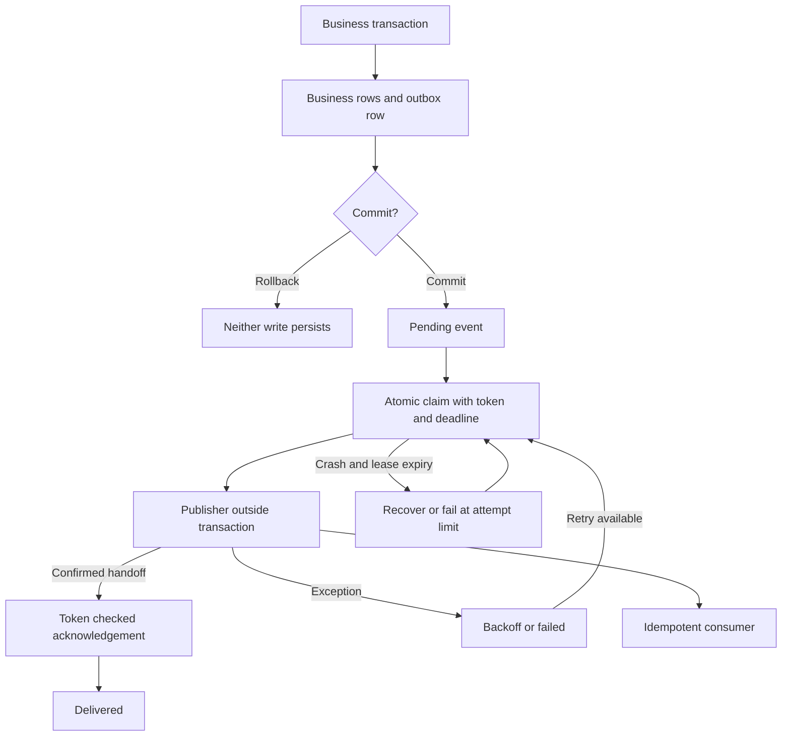

# laravel-outbox

A small transactional outbox for Laravel. Commit a domain event alongside a business write, then publish it from a separate Artisan process with recoverable database leases.

**Delivery is at-least-once, not exactly-once.** Consumers must deduplicate using the stable event ID. Finite retries can leave events in `failed`; continued delivery requires monitoring and operator replay. There is no unconditional eventual-delivery guarantee.

## Compatibility

Targets **Laravel 13.x and PHP 8.3+** with Orchestra Testbench 11. Laravel's official [release notes](https://laravel.com/framework/docs/releases) identify Laravel 13 as the current stable major (checked October 27, 2026). Testbench 11 is the matching test harness. Composer resolves the compatible patch versions; `TESTING.md` records actual local validation.

Database scope: SQLite 3.35+, MySQL 8.0+ **with InnoDB**, and PostgreSQL 16+. The package uses conditional SQL updates rather than `SKIP LOCKED`, so all three use the same claim algorithm. CI runs SQLite, MySQL 8.0, and PostgreSQL 16; CI configuration alone is not proof that a remote run passed. Other engines and MySQL nontransactional tables are unsupported.

## Install

The Composer package identifier is `outbox/laravel-outbox`; the repository name is `laravel-outbox`. It is not assumed to be registered on Packagist. Install from a local checkout:

```bash
composer config repositories.laravel-outbox path ../laravel-outbox
composer require outbox/laravel-outbox:@dev
php artisan vendor:publish --tag=outbox-config
php artisan vendor:publish --tag=outbox-migrations
php artisan migrate
```

Laravel discovers the service provider automatically. Without discovery, register `LaravelOutbox\OutboxServiceProvider` in `bootstrap/providers.php`. For a future published GitHub repository, configure a Composer VCS repository using its real URL, or register the package on Packagist and tag a release. No fictitious remote URL is needed.

## Write an event in the business transaction

```php
use Illuminate\Support\Facades\DB;
use LaravelOutbox\Outbox;

$outbox = app(Outbox::class);
$connection = DB::connection(config('outbox.connection'));

$eventId = $connection->transaction(function () use ($connection, $outbox): string {
    $orderId = $connection->table('orders')->insertGetId([
        'reference' => 'ORDER-123',
    ]);

    return $outbox->record('order.placed.v1', [
        'order_id' => $orderId,
    ], ['source' => 'checkout']);
});
```

`record(string $type, array $payload, array $metadata = []): string` returns a UUID and inserts immediately. JSON encoding errors throw. Rollback removes both writes; outer transactions and savepoints retain their normal Laravel semantics. Recording without an active transaction on the configured connection throws `LogicException`.

**You must use the exact same Laravel connection instance for business writes and the outbox insert.** The guard detects a missing transaction; it cannot inspect unrelated business writes or prove that a transaction on another connection is coupled. For Eloquent, ensure models use this connection. Separate PDO connections to the same database are still separate transactions. This package does not implement distributed transactions.

Use a schema-versioned type and JSON-safe payload. Events are snapshots, so avoid serializing models, secrets, or closures. The UUID primary key identifies an outbox row; calling `record` twice intentionally creates two different events. This is not a producer idempotency-key API.

## Publish

```bash
php artisan outbox:publish --limit=100
```

Each invocation drains at most `limit` claims and exits. It can run concurrently in multiple processes. Schedule it in `routes/console.php`:

```php
use Illuminate\Support\Facades\Schedule;
Schedule::command('outbox:publish --limit=100')->everyMinute();
```

Run Laravel's scheduler as usual. For lower latency, invoke the command more frequently through your supervisor/scheduler. Each event is claimed just before publication; the command never preclaims a large batch. An invocation may exit with no claim under contention; the next scheduled invocation tries again. Per-event publisher failures do not prevent other events from being attempted. Exit code 1 reports any publisher failure or lease loss, 2 an invalid limit, and 0 a clean run. Database/infrastructure exceptions propagate for visibility and crash recovery.

### Laravel event / queue example

The default `LaravelEventPublisher` dispatches `LaravelOutbox\Envelope` through Laravel's event dispatcher. Register a listener in an application service provider:

```php
use Illuminate\Support\Facades\Event;
use LaravelOutbox\Envelope;

Event::listen(Envelope::class, \App\Listeners\HandleOutboxEvent::class);
```

A complete queued listener example is in [`examples/HandleOutboxEvent.php`](examples/HandleOutboxEvent.php). It implements Laravel's `ShouldQueue`, so the dispatcher hands the envelope to your configured queue. Use a durable queue driver, not `sync`, when durable asynchronous handoff is required. Run `php artisan queue:work`. The outbox `delivered` status means the dispatcher returned; for queued listeners it means enqueue succeeded, **not** that the consumer completed. A custom driver that acknowledges before durable storage weakens that handoff. With no listener registered, Laravel dispatch succeeds without doing work; register and verify the listener before publishing.

For synchronous listeners, an exception triggers outbox retry. Multiple listeners can partially succeed before another throws; earlier listeners will run again. Avoid stopping event propagation by returning `false` when all listeners need delivery.

### Custom transport

```php
use LaravelOutbox\Contracts\Publisher;
use LaravelOutbox\Envelope;

final class BrokerPublisher implements Publisher
{
    public function __construct(private YourBrokerClient $broker) {}

    public function publish(Envelope $event): void
    {
        $this->broker->sendConfirmed([
            'id' => $event->id,
            'type' => $event->type,
            'payload' => $event->payload,
            'metadata' => $event->metadata,
            'occurred_at' => $event->occurredAt,
        ]);
    }
}
```

`YourBrokerClient::sendConfirmed` is application transport pseudocode, not a supplied client. Return only after the destination acknowledges handoff; throw on failure. Set `outbox.publisher` to your container-resolvable publisher class. The envelope also contains the 1-based `attempt`, which is delivery metadata and is not part of the event identity. See [`examples/record-order.php`](examples/record-order.php) for a runnable-in-Laravel database example.

## Claims, crashes, and retries

1. A worker selects up to 100 eligible candidate IDs from the **write connection**. Reads are hints and do not confer ownership.
2. It executes a single conditional `UPDATE` on one ID. The update requires either an available `pending` row or an expired `processing` row, and attempts below the limit. It sets a fresh UUID claim token, a lease deadline, and atomically increments attempts.
3. Only a worker whose update affected one row owns that lease. SQLite serializes writers; InnoDB and PostgreSQL serialize competing updates on a row and recheck the predicate. There is no select-then-unconditional-update race and no database lock is held while publishing. Database busy/deadlock errors propagate; the next invocation can retry safely.
4. Publication runs outside database transactions. Success/failure updates require the same token, `processing` status, and an unexpired lease. Old tokens cannot acknowledge or fail a replacement claim.
5. After a crash, an expired row can be reclaimed with a new token. A crash on the final attempt is marked `failed` on the next poll after expiry, with an explicit unknown-outcome error.

Supported DB references: [SQLite isolation](https://sqlite.org/isolation.html), [MySQL InnoDB locking](https://dev.mysql.com/doc/refman/8.0/en/innodb-locking.html), and [PostgreSQL Read Committed](https://www.postgresql.org/docs/16/transaction-iso.html#XACT-READ-COMMITTED). PostgreSQL deployments should use the default Read Committed isolation; use normal Laravel autocommit for the worker. Claims, acknowledgements, and retries explicitly reject active transactions on the outbox connection. Do not wrap command execution in a transaction or change session autocommit.

The default lease is 60 seconds, attempt limit 10. A thrown publisher error schedules `min(max_backoff_seconds, backoff_seconds * 2^(attempt-1))` seconds later (5, 10, 20… capped at 3600). A crash has an unknown outcome, so recovery waits for lease expiry rather than using this exception backoff. Attempts count claims, including crashes before publication. On the final thrown failure the row becomes `failed` immediately.

**A lease prevents two workers from owning the same unexpired claim, not two external effects after expiry.** There is no heartbeat or external fencing protocol. Configure transport timeouts below the lease with headroom; a paused/slow worker may continue sending while another reclaims its expired lease. Tokens fence database state only. Synchronize application host clocks (epoch seconds use application time), since clock skew can cause early recovery. No strict delivery ordering is promised, including for events for the same aggregate.

### Inspect and replay failures

Inspect `outbox_events` for `status = 'failed'`, `attempts`, and `last_error`. Monitor pending age, expired leases and command failures. `last_error` stores a truncated exception class/message (4,000 characters); do not put secrets in exception messages. Structured warnings contain event ID, attempt and error class without payloads. Protect access to the table and apply your own retention policy. No automatic pruning deletes evidence.

```bash
php artisan outbox:retry EVENT_UUID
```

This only transitions a `failed` row to `pending`, retains its ID/payload and diagnostic error, and resets attempts. It can produce duplicates if a previous handoff actually succeeded. Requeue a known event after investigating; do not edit active claim tokens manually. Restart workers after changing config because settings are resolved once per process. `outbox.connection` must also match the connection used when running migrations.

## Why at-least-once?

A database transaction cannot atomically commit an external broker acknowledgement. If publish succeeds and the process dies before setting `delivered`, the lease expires and the event is published again. Transport timeouts can also hide a successful send. Suppressing that retry would risk losing the event. Consumers should atomically insert `event.id` into an inbox table with a **unique constraint** and apply local business writes in that same consumer transaction; duplicate-key means already handled. Checking for an ID and then inserting without atomic uniqueness is unsafe. External consumer effects need their own idempotency keys or outbox, too.

## Why not just `afterCommit`?

Laravel's [`afterCommit` queue dispatch](https://laravel.com/framework/docs/queues#jobs-and-database-transactions) prevents a queued job from being dispatched before the enclosing transaction commits, and discards deferred dispatch on rollback. It does not persist a separate delivery intent in your business transaction. A process crash after commit but before the deferred dispatch can lose that intent. An outbox row survives that gap and can be polled by another process. It adds storage, retries, monitoring and consumer deduplication; it does not remove duplicate delivery. Combining the two is optional: an after-commit wakeup can reduce latency, while polling remains the recovery mechanism. This package relies on polling and needs no callback to survive.

## Architecture



The diagram's delivery path assumes the lease is still valid at acknowledgement. A lost lease leaves the event recoverable; a consumer may have already received it.

## Development

```bash
composer install
composer validate --strict
composer lint
composer test
```

Tests use Orchestra Testbench with real migrations and database operations. They cover rollback, wrong connection, transaction guards, successful Laravel dispatch, retry timing, dead-lettering, expired claims, stale acknowledgements/failures, slow publication, duplicate delivery after simulated crash, a forced stale-selection interleaving, two independent PHP processes racing for a row, and duplicate database-queue deliveries deduplicated by a transactional inbox. Crash tests simulate the exact durable boundary by omitting ack/fail; they are not host power-loss durability tests.

For MySQL/PostgreSQL use a **dedicated disposable** database named `outbox_test` and set `TEST_DB=mysql` or `TEST_DB=pgsql`, `DB_HOST`, `DB_PORT`, `DB_USERNAME`, `DB_PASSWORD`. Tests recreate `orders` and `outbox_events`; never point them at production. The GitHub Actions matrix exercises those engines and PHP 8.3–8.5.

MIT licensed. Small by design: no broker implementation, consumer framework, saga engine, or cross-database atomicity.
